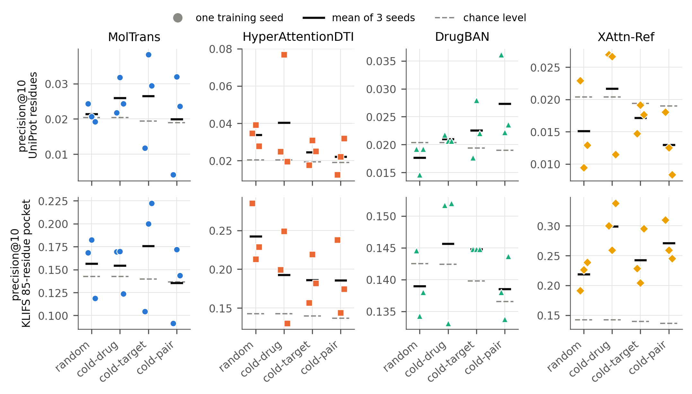
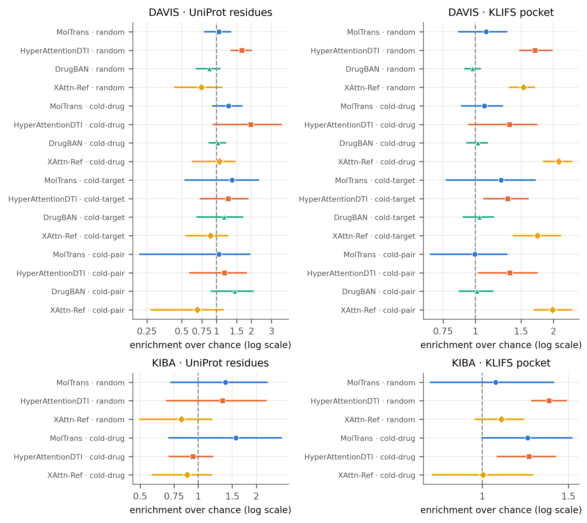
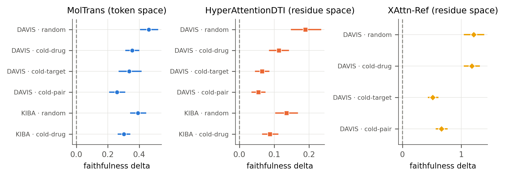
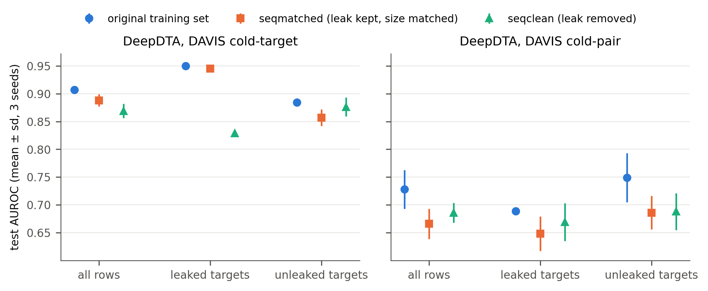

# Seed-dependent verdicts: a calibrated audit of attention-based binding-site explanations in drug–target interaction models

## Abstract

**Motivation:** Attention maps over the protein can be read as evidence of where a drug binds, and a figure from a single training run on a
random split is the simplest such report. We ask whether such binding-site verdicts are stable enough to report.

**Results:** We retrained four attention-based drug–target interaction models (MolTrans, HyperAttentionDTI, DrugBAN and XAttn-Ref,
an in-house reference model) and a no-attention accuracy anchor, three seeds each, on identical kinase splits at up to four levels of
distribution shift (84 trained cells on DAVIS and KIBA), and scored explanations against chance, a positive control, nulls and size-matched
masking controls, with Holm correction over declared families.
In 11 of 22 model–dataset–level cells the three seeds fall on different sides of the uncorrected α = 0.05 threshold of their own
verdict, and in 21 of 22 the seeds' range exceeds the cell's distance from chance.
After Holm correction (on the median p over seeds), 1 of 20 DAVIS cells supports residue-level recovery (HyperAttentionDTI, random split, 1.66× chance) and 0 of 8 KIBA cells do.
What replicates is coarser: masking the attended residues is load-bearing for three of the four models (not consistently for DrugBAN), and the ATP pocket is
enriched in XAttn-Ref's maps at every DAVIS level and HyperAttentionDTI's at three of four (point estimates 1.33–2.10× chance; conservation not controlled).
DAVIS's duplicated wild-type sequences inflate a DeepDTA baseline's cold-target AUROC by 0.116 (p = 0.0013) on the leaked rows, but not
detectably (−0.019, p = 0.31) on the unleaked rows.

**Conclusion:** A single-seed attention figure cannot carry a residue-level binding-site claim; report verdicts across seeds, against
chance and a positive control, with correction and a stated readout.

**Availability and implementation:** Code, splits, analysis outputs and the figure scripts are at
https://github.com/Mahim56207/ColdSite-DTI_New. **[TO ADD BEFORE SUBMISSION — not yet done: an archived release with a DOI
(Zenodo or similar), which the journal requires in this line, and the public location of the trained checkpoints.]**

**Contact:** [corresponding author's e-mail — to be added by the author]

**Supplementary information:** Supplementary data are available online. [Wording to be matched to the template.]

**Mahim Agarwal** [affiliation and e-mail: to be added by the author]; supervised by **Dr. Chandra Mohan Dasari**.

# 1 Introduction

Several sequence-based drug–target interaction (DTI) models come with an explanation beside the prediction: an attention map over the
protein, read as marking where the drug binds. MolTrans (Huang et al., 2021) describes its interaction module as making prediction interpretable,
HyperAttentionDTI (Zhao et al., 2022) assigns an attention vector to each atom and amino acid, and DrugBAN (Bai et al., 2023) is titled an interpretable
bilinear attention network; later work reports interpretability alongside cold-start accuracy (for example GPS-DTI; Xiong et al., 2025).
A chemist choosing residues to mutate may reasonably read such a figure as mechanistic evidence. Whether it can bear that reading is an
empirical question about the figure, not about the model's accuracy.

The question has a history. In natural-language processing, attention weights were found to diverge from other importance measures (Jain and
Wallace, 2019; Serrano and Smith, 2019), and the conditions under which attention can serve as an explanation were debated (Wiegreffe and
Pinter, 2019). Two properties must be kept apart: *plausibility*, whether the highlighted residues are those an expert would name, and
*faithfulness*, whether the prediction depends on them (DeYoung et al., 2020). In DTI, attention has been compared with interaction
annotations before. MONN (Li et al., 2020) built a benchmark of non-covalent interactions and reported that attention-based models, without
extra supervision, did not give satisfactory interpretability; ICAN (Kurata and Tsukiyama, 2022) reported that some weighted sites in its
cross-attention matrix match experimental binding sites with statistical significance; and a recent preprint (InteractBind; Meng et al.,
2026) reports limited binding-site localisation despite strong binding prediction. Our contribution is therefore not another comparison of
attention with binding sites. It is the question of whether such comparisons, as usually reported, are *stable and calibrated enough to
support a verdict at all*.

Three features of a single-run report make that doubtful. First, the figure comes from one training run, yet nothing guarantees that a second run
of the same recipe attends to the same residues. Second, a hit rate means little unless it is read against the protein's chance level, the ceiling the
ground truth allows, a uniform map and a planted explanation of known quality, and comparisons across many cells need family-wise
correction. Third, "the attention map" is not one object: a multi-head, multi-channel model must be reduced to one weight per residue, and
that reduction is a choice. Behind all three sits the benchmark: DAVIS's cold-start splits are defined by target identifiers, which are
not sequences, and the standard DAVIS release omits the modifications of its mutant kinases (Wu et al., 2025, preprint).

We therefore present a methodological audit, not a new model. Three published attention-based models (MolTrans, HyperAttentionDTI,
DrugBAN) and XAttn-Ref, an in-house cross-attention model trained and scored identically, are retrained with their authors' recipes on
identical kinase splits, three seeds per cell, at four levels of distribution shift on DAVIS (random, unseen drug, unseen target, both)
and two on KIBA (random, unseen drug; DrugBAN is on DAVIS only); DeepDTA, which has no attention, anchors accuracy. The DAVIS arm has 60 cells and the KIBA arm 24.
Plausibility is precision@10 against UniProt's annotated binding residues and against the KLIFS 85-residue ATP pocket, each read against its
own chance level and ceiling; faithfulness is the change in prediction when the attended residues are masked, against a random-masking
control of the same size.
A "seed" here is a full retraining with a different seed; we do not separate seed variance from other run-to-run variation (Section 4).

Our main findings are four. **(a) The verdicts are not self-consistent across seeds.** In 11 of the 22 model–dataset–level cells scored
against UniProt residues, the three seeds fall on different sides of the uncorrected α = 0.05 threshold of an exact permutation test, and in
21 of the 22 the seeds' range of precision@10 exceeds the cell's distance from chance.
**(b) Under a calibrated battery, residue-level claims rarely survive.** After Holm correction, 1 of 20 DAVIS cells supports residue-level
recovery (HyperAttentionDTI, random split, 1.66× chance) and 0 of 8 KIBA cells do; what replicates is coarser, namely load-bearing
attention for three of the four models and enrichment of the ATP pocket.
**(c) The verdict depends on the readout**, that is, on how a multi-channel map is reduced to one weight per residue (shown for HyperAttentionDTI), and on what
the map is a function of. **(d) The benchmark leaks:** on DAVIS's leaked cold-target rows, the sequence match inflates a DeepDTA baseline's AUROC by 0.116
(p = 0.0013), with no detectable inflation on the unleaked rows.

**Scope.** Every claim concerns kinase targets (DAVIS and KIBA are kinase panels). Training seeds four and five, DrugBAN on KIBA, further
explanation methods and a conservation control are declared in the protocol amendment but have not been run; they are limitations, not
results.

# 2 Methods

## 2.1 Data, task and splits

DAVIS (Davis et al., 2011) and KIBA (Tang et al., 2014) are used as distributed with DeepDTA (Öztürk et al., 2018). Every model solves the same
binary task: a pair is positive if pKd ≥ 7.0 on DAVIS or its KIBA score is ≥ 12.1, one constant shared by all trainers.
Each dataset is split at four levels of distribution shift: random; cold-drug, where test drugs are absent from training; cold-target, where test
targets are absent; and cold-pair, where both are. There is one fixed split per level; the three seeds of a cell change weight initialisation and
batch order only, so the spread across seeds is training variance, not split-selection variance. DAVIS has 30,056 labelled pairs over 442 targets.

**Targets are sequences, not identifiers.** The splits hold targets out by name, but DAVIS's 442 targets are 379 distinct sequences: 54 mutant
targets carry exactly the wild-type sequence. Consequently 12 of the 88 cold-target test targets and 11 of the 88 cold-pair test targets are
identical in sequence to a training target, and 10 targets hold too little of the kinase domain to contain its ATP pocket.
No model is retrained to correct this; the evaluation stops counting what it should not. Explanation metrics drop seen-by-sequence and
pocketless targets and count one protein per distinct sequence, and cold-level accuracy is reported on the sequence-unseen test targets as well as on
all of them. KIBA's 229 targets are 229 distinct sequences, and none is excluded.

## 2.2 Models and training

Four attention-based models are audited: MolTrans (Huang et al., 2021), HyperAttentionDTI (Zhao et al., 2022), DrugBAN (Bai et al., 2023) and
XAttn-Ref. XAttn-Ref is the authors' own model (repository name ColdSite-DTI): a two-branch encoder whose drug representation queries the residues
through one cross-attention layer. It receives exactly the same training protocol and analysis as the published models, and its results are reported
whether favourable or not. DeepDTA, which has no attention, anchors accuracy and is never scored for explanations.

The published models are trained from their vendored repositories with their authors' optimiser, learning rate, batch size and tokeniser; only data
loading is replaced, apart from the mixed precision on KIBA described below. All models share one checkpoint rule: up to 100 epochs, the checkpoint with the lowest validation loss among epochs ≥ 10, and
early stopping after 15 epochs without improvement (10 for DeepDTA).
DAVIS cells are trained in full precision. On KIBA, DeepDTA and HyperAttentionDTI use mixed precision, whereas MolTrans (whose hand-written layer
normalisation underflows in half precision) and XAttn-Ref use full precision; the precision of every cell is recorded in its results file. Mixed precision was checked beforehand on one DAVIS cell (HyperAttentionDTI, cold-pair, three seeds per arm), where test AUROC and precision@10 stayed within the full-precision seed spread; three seeds detect only a gross effect and cannot show equivalence (Supplement).
 DrugBAN is
trained on DAVIS only. Training ran on Kaggle sessions with two NVIDIA T4 GPUs, one independent job per GPU.

The explanation scored for each model is the readout of the primary analysis: MolTrans's protein-encoder self-attention
(last layer, mean over heads), HyperAttentionDTI's channel-mean attention placed at the centre of each convolution window, DrugBAN's bilinear
attention summed over drug atoms and averaged over heads, and XAttn-Ref's cross-attention weights; each is projected to one non-negative weight per
residue. Whether each primary readout matches the map its authors display has not been confirmed against their figures; alternative readouts are
a sensitivity analysis (Supplement).

## 2.3 Ground truths and plausibility

Two ground truths at different resolutions are used. **UniProt residues**: sequence features of type Binding site, Active site and Nucleotide
binding (The UniProt Consortium, 2025), re-numbered onto each dataset sequence by alignment so that a site points at the residue the model read.
**KLIFS pocket**: the 85 residues lining the ATP cleft of every kinase (van Linden et al., 2014; Kanev et al., 2021), placed on each sequence by the
same alignment. Proteins are scored within their first 1,000 residues.
Plausibility is precision@k, the fraction of a protein's k most-attended residues that are sites, with k = 10 fixed before any result existed. It is
computed on one test pair per protein, so that proteins measured against many drugs are not weighted by that count. Each protein's chance level is
(sites in the window) ÷ (window length), the exact expectation for k uniformly random residues, and its ceiling is min(sites, k) ÷ k.

## 2.4 The calibrated battery

A verdict is read only against the following instruments, each implemented once and applied identically to every model it covers.

**Chance, ceiling and a uniform floor.** Every precision@k is reported beside its chance and ceiling, and a uniform map (equal weight on every
residue) is passed through the same grid as an additional subject.

**Permutation test and family-wise correction.** For each cell the null draws k random residues per protein and averages over the split, preserving
the split's mix of lengths and site counts; the p-value uses the add-one estimator over 10,000 permutations, and the **median over the three seeds** is
the cell's p-value. Holm correction (Holm, 1979) is applied once over each dataset's family: 20 DAVIS cells (four models and the uniform map at four
levels) and 8 KIBA cells (three models and the uniform map at two levels).
The survival counts reported here (1 of 20 DAVIS cells, 0 of 8 KIBA cells) therefore describe this median-over-seeds rule, not individual seeds: a
Holm correction over the 48 per-seed exact tests instead retains 5 seed-runs, and over the 18 KIBA per-seed tests 3, because single seeds can clear a
corrected threshold that their median does not. Recomputing the Holm correction from the exact per-seed p-values instead of the 10,000-permutation estimates leaves the same survivors (1 of 20 and 0 of 8).
The families are declared, not pre-registered: they grew from 16 to 20 (DAVIS) and from 6 to 8 (KIBA) when DrugBAN and XAttn-Ref's KIBA cells were
added after the first results, and were frozen by a dated protocol amendment before any further analysis.

**Positive control.** Explanations of known quality are scored by the same functions on the real test proteins: at dose d, each true site is ranked
above every non-site with probability d. The oracle (d = 1) reaches its ceiling, and a dose of 0.02 is detected at every DAVIS level, so a null result
reflects the explanation and not the test's resolution.

**Positional and residue-identity nulls.** Borrowed-map, same-residue and within-span nulls test whether an above-chance score could arise from where in
the sequence a map concentrates, or which amino acids it prefers, rather than from the sites.

**Faithfulness.** For the first 200 test pairs of each level, the ten most-attended residues are masked and the change in the model's prediction is
compared with the mean change over five random maskings of the same size; the reported quantity is that difference, and the map is *load-bearing*
if it is above zero. A masked residue becomes the unknown amino acid `X` and is re-tokenised by each model's own tokeniser, so every model receives
the same intervention.

## 2.5 Seed instability and effect sizes

For each model, dataset and level, each seed's precision@10 is tested alone at α = 0.05, uncorrected, as a single-seed report would be. A cell's seeds
*disagree* if some but not all of them clear α, and its spread *exceeds its signal* if the range of the seeds' precision@10 is larger than the
distance of their mean from chance. The per-seed p-value is exact: each protein's hits under the null are hypergeometric and independent, and the
p-value is the upper tail of their convolution. Seed variance is also tested directly on the per-protein precision@10 of the three seeds, by a Friedman
test and by a permutation test that shuffles the seed labels within each protein (20,000 permutations), each Holm-corrected over the 22 cells.

Effect sizes carry 95% percentile intervals from a two-way bootstrap with 10,000 resamples that draws the proteins with replacement and, independently,
the three seeds with replacement, so an interval carries seed-to-seed variance as well as protein sampling; with three seeds the seed draw is coarse
and the intervals are conservative. Enrichment over chance is the ratio of mean precision@10 to mean chance over the same resampled proteins.
The protocol amendment had specified a bootstrap over proteins only; those intervals, which omit seed variance, are kept in the Supplement and quoted only where
the contrast is the point.
Accuracy is reported as AUROC and AUPRC, mean ± sample SD over three seeds. The association between accuracy and localisation is described by
Spearman's ρ across cells with a bootstrap interval; it is a description, not a test.

## 2.6 Quantifying the DAVIS leak

The accuracy anchor (DeepDTA) was retrained at the cold-target level on two further training sets of equal size (17,748 rows): one with every
seen-by-sequence target removed, and one that keeps the leaked targets while matching that row count and positive count. The difference between the
two, per seed and on the same test set, is the leak; the difference between the original and the matched set is the cost of the smaller training set.

## 2.7 Reproducibility

Analysis runs from one entry point per dataset. Split and ground-truth files are fixed by SHA-256 in a manifest, the vendored models are unmodified,
and every number in this manuscript carries a machine-checked source tag. Code and outputs: see Availability.

# 3 Results

## 3.1 Accuracy of the retrained models

Every model was retrained with its authors' recipe and scored on the same test sets (full table in the Supplement). At DAVIS's random level all five
reach a test AUROC between 0.891 (DrugBAN) and 0.937 (HyperAttentionDTI), so the explanation results below do not come from models that failed to
train. Accuracy falls with distribution shift, most at the cold-pair level, where it ranges from 0.568 (MolTrans) to 0.728 (DeepDTA, which has no
attention), and the seed-to-seed standard deviation grows with it: 0.001–0.006 at the random level against 0.025–0.099 at cold-pair.

## 3.2 Binding-site verdicts are not self-consistent across training seeds

Scored against UniProt's annotated residues, the three seeds of a cell disagree about their own verdict (they fall on different sides of the
uncorrected α = 0.05 threshold of a per-seed permutation test, as a single-run report would quote it) in 11 of 22 model–dataset–level cells (8 of 16
on DAVIS, 3 of 6 on KIBA). Only 1 cell has all three seeds above the threshold; 10 have none (Figure 1; per-cell values in Supplementary Table S6).
The per-seed p-values are exact, so no sampling error enters. A count on a threshold is threshold-dependent (8 at α = 0.01, 13 at α = 0.10), and we
report 11 as the exact-test value at the conventional α, not as a constant of the recipes.
The disagreement is not marginal: HyperAttentionDTI at DAVIS cold-drug places 0.025, 0.077 and 0.019 of its top-ten residues on annotated sites
against a chance of 0.020. In 21 of 22 UniProt cells the range of the three seeds' precision@10 exceeds the cell's distance from chance.
Taken alone this descriptive criterion is weak, because a cell whose mean sits near chance meets it almost by construction, so we test seed variance
directly: Friedman tests over proteins and within-protein seed-label permutation tests find significant differences between the three seeds in 13 and
10 of the 22 cells before correction, and in 8 and 7 of 22 after Holm correction over the 22 cells.
The variation is not scoring noise: collecting the explanations again from the same checkpoints moves precision@10 by a standard deviation of 0.0008
per seed, against a between-seed standard deviation of 0.0121.
A bootstrap over proteins, the usual way to attach an interval to such a score, does not see this variance: for HyperAttentionDTI at DAVIS cold-drug it
gives an enrichment over chance of 1.98 [1.81, 2.15], an interval far from parity, for a cell whose seeds disagree and whose family-wise test fails. The
two-way bootstrap that resamples seeds as well, used for every interval below, gives the same cell [0.94, 3.65].

**Figure 1. The same recipe, three seeds, different verdicts.** Precision@10 of each training seed (points) on DAVIS at four levels of shift, against UniProt residues (top) and the KLIFS 85-residue pocket (bottom). Black bar: mean of the three seeds; dashed tick: that level's exact chance level. Seeds of one recipe that fall on both sides of chance are the instability reported here. The y-axes differ between panels.

## 3.3 Under the calibrated battery, residue-level recovery rarely survives

The positive control sets the test's resolution: an explanation that ranks as little as 0.02 of the true sites first is detected at every DAVIS level, so
a null below is a property of the maps and not of the test. With Holm correction over each dataset's declared family, 1 of 20 DAVIS cells supports
residue-level recovery and 0 of 8 KIBA cells do. These counts describe the median-over-seeds rule of Section 2.4, not individual seeds.
The surviving cell is HyperAttentionDTI at the random level (precision@10 0.034 against a chance of 0.020; enrichment 1.66 [1.33, 2.00]), at p = 0.0001,
the smallest value 10,000 permutations can give. The uniform map, passed through the same grid, never approaches significance (p of 0.4462 or more on
DAVIS, 0.2251 or more on KIBA), so the test does not reward a map for being flat.
Once seeds are resampled the intervals agree with the correction: of the 22 UniProt cells, only this one has an interval above parity (Figure 2).
With proteins alone resampled, several more would, for example MolTrans at KIBA cold-drug, 1.57 [1.32, 1.82]; resampling seeds widens that interval to
[0.70, 2.70], and its split-level test does not survive (p = 0.07279 against a threshold of 0.00625).

## 3.4 What replicates is coarse: pocket enrichment and load-bearing attention

Against the 85-residue KLIFS pocket, where chance is 0.137–0.143 on DAVIS, XAttn-Ref's map is enriched at every DAVIS level (1.54–2.10× chance) and
HyperAttentionDTI's at three of the four (1.33–1.70×, cold-pair only marginally); at cold-drug HyperAttentionDTI's interval, 1.35 [0.94, 1.73], includes
parity once seeds are resampled. MolTrans's intervals include parity at every level, and DrugBAN's map sits on chance throughout (0.98–1.04×)
(Figure 2). On KIBA, XAttn-Ref's cold-drug map is at chance (1.00 [0.79, 1.27]).
Kinase ATP pockets are conserved and no conservation control was run, so this is a statement about a conserved region, not evidence that a ligand's
contacts were learned. The positional nulls do rule out the simplest artefact for HyperAttentionDTI: its pocket hits beat a shuffle of the same attention
within the kinase domain in eight of its twelve seed-level cells (uncorrected), so the map prefers the pocket within the domain, not only the domain.

Faithfulness is the most stable property measured for three of the four models. In all 16 cells of HyperAttentionDTI, MolTrans and XAttn-Ref, masking
the attended residues changes the prediction more than masking the same number of random ones, with every 95% interval above zero even when seeds are
resampled (Figure 3); the effect ranges from 0.054 [0.030, 0.080] (HyperAttentionDTI, DAVIS cold-pair) to 1.21 [0.68, 1.92] (XAttn-Ref, DAVIS random),
and MolTrans, measured in its own token space, is not on the same scale. The sign holds in every seed, but its size does not: within a cell the per-seed
deltas differ several-fold.
DrugBAN's attention is not consistently load-bearing: its deltas sit near zero and change sign between seeds (at cold-drug −0.0073, −0.0036 and 0.0128 for seeds one
to three), six of its twelve seed-level deltas are negative, and no level is load-bearing in all three seeds. They are point estimates only, because its
run did not record per-pair values and no interval can be attached.
Finally, accuracy does not predict localisation: across the 48 DAVIS attention-model cells, Spearman's ρ between AUROC and enrichment over chance is
0.003 [−0.309, 0.294].

**Figure 2. Enrichment over chance with 95% bootstrap intervals.** Precision@10 divided by chance for every model and level, DAVIS (top) and KIBA (bottom), against UniProt residues (left) and the KLIFS pocket (right). Intervals are 95% percentile intervals from a two-way bootstrap that resamples both proteins and seeds (10,000 resamples); log scale; the dashed line is chance (an enrichment of one). Pocket-level enrichment is not controlled for residue conservation. Exact values are in Supplementary Table S7.

**Figure 3. Masking the attended residues matters more than masking random ones.** Faithfulness delta (attended masking minus a size-matched random-masking control), mean over proteins, with 95% two-way bootstrap intervals (proteins and seeds resampled, 10,000 resamples). MolTrans is measured in its own token space and the others in residue space, so the three panels do not share a scale. DrugBAN is not drawn: its per-seed deltas are reported in the text but carry no interval, because its per-pair values were not recorded. No KIBA cell exists for XAttn-Ref.

## 3.5 The verdict depends on the readout and on what the map is a function of

A multi-channel attention tensor must be reduced to one weight per residue, and the choice decides the verdict. Two defensible reductions of the same
HyperAttentionDTI weights place 0.367 and 0.081 of their top-ten residues in the ATP pocket at the cold-target level, against a chance of 0.140, a single model and level.
Whether a map can depend on the drug is a property of the computation graph. For 25 proteins each paired with four drugs, the MolTrans readout scored
here gives the same top ten for every drug (100% of 150 drug pairs), HyperAttentionDTI's in 72%, and DrugBAN's in 0%. A map that cannot change with
the drug cannot mark that drug's binding site, whatever its hit rate. MolTrans's interaction map, a different readout of the same model, does change with the drug (identical top ten in 0% of the same 150 pairs).

## 3.6 DAVIS's sequence leakage, quantified

DAVIS gives 54 of its mutant targets exactly the wild-type sequence, so 12 of the 88 cold-target test targets are seen by sequence in training: 816 of
5984 test rows (13.6%).
The retrain was made on DeepDTA, the accuracy anchor, at the cold-target split, with three seeds, and separates the leak from the loss of training rows
(Figure 4). On the leaked rows the sequence match inflates AUROC by 0.116 (95% t-interval [0.098, 0.134], p = 0.0013). On the strictly unleaked rows no
inflation is detectable (−0.019, p = 0.31). Over all rows the net effect is 0.019 with an interval, [−0.022, 0.059], that includes zero (p = 0.19), because
the leaked rows are 13.6% of the test set; we therefore do not quote the all-rows figure as a finding. Explanation metrics exclude seen-by-sequence
targets throughout.

**Figure 4. What DAVIS's sequence leakage is worth to the accuracy anchor.** DeepDTA test AUROC (mean ± SD over three seeds) at cold-target and cold-pair, retrained on three training sets: the original split, "seqclean" (every seen-by-sequence target removed) and "seqmatched" (the leaked targets kept, at the size of "seqclean"). "seqmatched" minus "seqclean" isolates the leak; "original" minus "seqmatched" is the cost of fewer rows. Scored on all test rows and separately on leaked and unleaked targets.

Every result in this section concerns kinase targets; the non-kinase transfer panel is not analysed here.

# 4 Discussion

## 4.1 What the audit shows

The central result is that an attention-based binding-site verdict, as a single-run report presents it, is not a stable property of a model recipe. Three retrainings of
the same recipe on the same split frequently disagree about whether the map finds annotated residues (11 of 22 cells), the disagreement is usually larger
than the effect being claimed (21 of 22), and in 7 to 8 of 22 cells the differences between seeds are significant after correction.
A single-run figure therefore samples one draw from a wide distribution, and an interval computed over proteins alone does not reflect it. Once chance, ceiling, a
uniform floor, a positive control and family-wise correction are applied, residue-level recovery survives in one DAVIS cell and in no KIBA cell.

What does replicate is coarser. The attention of three of the four models is load-bearing in every seed; XAttn-Ref's map concentrates in the kinase ATP pocket at
every DAVIS level and HyperAttentionDTI's at three of four; DrugBAN is the exception on both counts. In the vocabulary of Jacovi and Goldberg (2020), these models
are faithful without being plausible at the residue level: their predictions depend on the residues they attend to, but those residues are rarely the annotated ones.
Pocket enrichment is also the weakest kind of plausibility, because the pocket is conserved across kinases; without a conservation control it cannot be read as
learned chemistry. Two further results bear on reporting: for HyperAttentionDTI the verdict depends on how a multi-channel tensor is reduced to one weight per residue, and our
primary readout for MolTrans cannot depend on the drug at all (its interaction map can). Accuracy, finally, is no guide to localisation.

## 4.2 Relation to prior work

Attention has been compared with binding-site annotations in DTI before. MONN (Li et al., 2020) reported that attention-based models, without extra supervision, did
not give satisfactory interpretability; ICAN (Kurata and Tsukiyama, 2022) reported that some cross-attention weights match experimental binding sites with statistical
significance on DAVIS; and InteractBind (Meng et al., 2026, preprint) found limited localisation despite strong binding prediction across eight models. Our
residue-level results are consistent with the first and third. What we add is that the verdict itself is unstable across retrainings, and a battery that states when a
single-model significance claim of the kind ICAN reports can be trusted. Two recent audits approach DTI explanations differently: ISAAC (Tarantino et al., 2026,
preprint) probes models with matched mechanistic and spurious interventions and reports scores stable across training seeds, and Vefghi et al. (2026, preprint) combine
gradient attributions and occlusion on one model and state that this does not substitute for structural ground truth. Ours is complementary: it scores explanations
against structural annotations, and for these models the localisation verdicts lack the seed stability ISAAC reports for its intervention scores; whether the two
measures would agree on the same models is untested.

The debate over attention as explanation (Jain and Wallace, 2019; Wiegreffe and Pinter, 2019) asked whether attention weights can be read as importance at all. Our
faithfulness results side with the view that they can carry importance, and our plausibility results show that importance and biological correctness are separate
questions. The drug-dependence check plays the role that model-randomisation tests play for saliency maps (Adebayo et al., 2018): an explanation that does not change
when the input that should matter changes cannot explain that input. On benchmarks, DAVIS's omission of mutant-kinase modifications (Wu et al., 2025, preprint) and the
leakage that permissive kinase splits can reward (Ong et al., 2023, preprint) have precedent; we add a measured effect on DeepDTA's cold-start accuracy, separated from the loss
of training data.

## 4.3 Recommendations

The following follow directly from these results (Box 1). (i) Report an explanation from several training runs, with the agreement between them and intervals that resample
runs as well as proteins. (ii) Read every hit rate against the protein's chance level and the ground truth's ceiling, with a uniform-map floor and a positive control that
states the smallest detectable effect. (iii) Correct for multiple comparisons across the family of cells shown. (iv) State the readout: which heads, layers, channels and pooling
produce one weight per residue, and which inputs it is a function of. (v) Test faithfulness with a masking control of the same size in the model's own token space.
(vi) Check cold-start splits for sequence identity, not identifier identity. The first and third would most change the conclusions of a single-model report,
and both are cheap relative to training.

## 4.4 Limitations

**A "seed" is a retraining, not a controlled source of variance.** We did not separate initialisation from other run-to-run variation. The cloud-harness canary retrained one
committed cell (XAttn-Ref, DAVIS cold-target, seed 1) three times with identical initial weights and the same GPU type: test AUROC came out at 0.8868, 0.8494 and 0.8705, against the committed 0.8501.
The first two attempts used the same library version and different versions of the harness code but the same training code; the third used a newer library version (docs/canary_attempts/README.md). This is
three reruns of one cell and not a variance estimate; it does show that fixing the seed does not fix the outcome. Our claim is therefore that verdicts differ between retrainings, which is
what a single-run report depends on, and not that initialisation is the cause. We also do not test why the maps disagree.

**Few seeds, and compute not yet run.** Three seeds are few for estimating seed instability. Seeds four and five of HyperAttentionDTI, MolTrans and XAttn-Ref, and DrugBAN on KIBA,
are planned and declared in a dated protocol amendment but have not been run, and none contributes to any number here; if they are run, they will be trained under a newer library version than seeds one to three (recorded for every cell), and the counts above will be recomputed and reported
beside, not merged into, the three-seed analysis. KIBA was trained at the random and cold-drug levels only, so every cold-target and cold-pair claim rests on DAVIS alone.

**Ground truth and scope.** All claims concern kinases; the non-kinase transfer panel is not analysed. UniProt annotations and the KLIFS pocket are structural ground truths that may be
demanding for sequence-only models, and the pocket is the lenient rung, with no conservation control. For each published model we score the readout of our primary analysis; whether it is the
map each paper displays has not been confirmed against the papers' figures, and given Section 3.5 a different primary readout could change a model's verdict. DrugBAN's faithfulness values
are point estimates without intervals. The permutation nulls and bootstraps treat proteins as independent, although many kinases are related and share both sites and attention; we did not model that dependence, and it could make the p-values and intervals optimistic.

**Design.** The Holm families are declared rather than pre-registered. DAVIS's cold-pair validation split contains seen-by-sequence targets, which may have influenced checkpoint selection and
cannot be undone without retraining. XAttn-Ref is the authors' own model; it was trained and scored identically, and its unfavourable results, including chance-level residue localisation, are reported.

## 4.5 Conclusion

For the four attention-based DTI models audited here, a single-seed attention figure cannot carry a residue-level binding-site claim: the verdict changes between retrainings, rarely survives a
calibrated test, and depends on the readout. What these maps show reliably is coarser: they are load-bearing for three of the four models and, for two, concentrated in the kinase
pocket at most DAVIS levels. Explanation claims in DTI should be reported across runs, against chance and a positive control, with correction and a stated readout, on splits checked for sequence
identity.

## Declarations [placeholders: wording and required items to be matched to the journal template, which is unverified]

* **Funding:** [to be completed by the author]
* **Conflict of interest:** XAttn-Ref is the authors' own model (Section 2.2); [formal statement to be completed by the author]
* **Data and code availability:** see the abstract; [archived release DOI and checkpoint location to be added]
* **Acknowledgements:** [to be completed by the author]

# References (v3, working list)

* Adebayo, J., Gilmer, J., Muelly, M., Goodfellow, I., Hardt, M., Kim, B. (2018) Sanity Checks for Saliency Maps. Advances in Neural Information Processing Systems (NeurIPS) 2018; arXiv:1810.03292.
* Bai, P., Miljković, F., John, B., Lu, H. (2023) Interpretable bilinear attention network with domain adaptation improves drug–target prediction. Nature Machine Intelligence 5, 126-136. doi:10.1038/s42256-022-00605-1
* Davis, M. I., Hunt, J. P., Herrgard, S., Ciceri, P., Wodicka, L. M., Pallares, G., Hocker, M., Treiber, D. K., Zarrinkar, P. P. (2011) Comprehensive analysis of kinase inhibitor selectivity. Nature Biotechnology 29, 1046-1051. doi:10.1038/nbt.1990
* DeYoung, J., Jain, S., Rajani, N. F., Lehman, E., Xiong, C., Socher, R., Wallace, B. C. (2020) ERASER: A Benchmark to Evaluate Rationalized NLP Models. Proceedings of the 58th Annual Meeting of the Association for Computational Linguistics, 4443-4458. doi:10.18653/v1/2020.acl-main.408
* Holm, S. (1979) A simple sequentially rejective multiple test procedure. Scandinavian Journal of Statistics 6, 65–70. JSTOR 4615733.
* Huang, K., Xiao, C., Glass, L. M., Sun, J. (2021) MolTrans: Molecular Interaction Transformer for drug–target interaction prediction. Bioinformatics 37, 830-836. doi:10.1093/bioinformatics/btaa880
* Jacovi, A., Goldberg, Y. (2020) Towards Faithfully Interpretable NLP Systems: How Should We Define and Evaluate Faithfulness? Proceedings of the 58th Annual Meeting of the Association for Computational Linguistics, 4198-4205. doi:10.18653/v1/2020.acl-main.386
* Jain, S., Wallace, B. C. (2019) Attention is not Explanation. Proceedings of the 2019 Conference of the North American Chapter of the Association for Computational Linguistics: Human Language Technologies, Volume 1 (Long and Short Papers), 3543-3556. doi:10.18653/v1/n19-1357
* Kanev, G. K., de Graaf, C., Westerman, B. A., de Esch, I. J. P., Kooistra, A. J. (2021) KLIFS: an overhaul after the first 5 years of supporting kinase research. Nucleic Acids Research 49, D562-D569. doi:10.1093/nar/gkaa895
* Kurata, H., Tsukiyama, S. (2022) ICAN: Interpretable cross-attention network for identifying drug and target protein interactions. PLOS ONE 17, e0276609. doi:10.1371/journal.pone.0276609
* Li, S., Wan, F., Shu, H., Jiang, T., Zhao, D., Zeng, J. (2020) MONN: A Multi-objective Neural Network for Predicting Compound-Protein Interactions and Affinities. Cell Systems 10, 308-322.e11. doi:10.1016/j.cels.2020.03.002
* Meng, Z., Bai, Z., Yuan, K., Ounis, I., Meng, Z., Xu, H., Loscalzo, J. (2026) A Large-Scale Dataset and Benchmark: Do Protein-Ligand Models Learn Binding Sites or Just Binding Likelihood? arXiv preprint, arXiv:2605.24045. **[preprint]**
* Ong, W. J. G., Kirubakaran, P., Karanicolas, J. (2023) Poor Generalization by Current Deep Learning Models for Predicting Binding Affinities of Kinase Inhibitors. bioRxiv preprint. doi:10.1101/2023.09.04.556234 **[preprint]**
* Öztürk, H., Özgür, A., Ozkirimli, E. (2018) DeepDTA: deep drug–target binding affinity prediction. Bioinformatics 34, i821-i829. doi:10.1093/bioinformatics/bty593
* Serrano, S., Smith, N. A. (2019) Is Attention Interpretable? Proceedings of the 57th Annual Meeting of the Association for Computational Linguistics, 2931-2951. doi:10.18653/v1/p19-1282
* Sundararajan, M., Taly, A., Yan, Q. (2017) Axiomatic Attribution for Deep Networks. Proceedings of the 34th International Conference on Machine Learning (PMLR 70); arXiv:1703.01365.
* Tang, J., Szwajda, A., Shakyawar, S., Xu, T., Hintsanen, P., Wennerberg, K., Aittokallio, T. (2014) Making Sense of Large-Scale Kinase Inhibitor Bioactivity Data Sets: A Comparative and Integrative Analysis. Journal of Chemical Information and Modeling 54, 735-743. doi:10.1021/ci400709d
* Tarantino, B., Kim, S., Lu, Y., Giudici, P. (2026) ISAAC: Auditing Causal Reasoning in Deep Models for Drug-Target Interaction. arXiv preprint, arXiv:2605.02962. **[preprint]**
* The UniProt Consortium (2025) UniProt: the Universal Protein Knowledgebase in 2025. Nucleic Acids Research 53, D609-D617. doi:10.1093/nar/gkae1010
* van Linden, O. P. J., Kooistra, A. J., Leurs, R., de Esch, I. J. P., de Graaf, C. (2014) KLIFS: A Knowledge-Based Structural Database To Navigate Kinase–Ligand Interaction Space. Journal of Medicinal Chemistry 57, 249-277. doi:10.1021/jm400378w
* Vefghi, A., Rahmati, Z., Akbari, M. (2026) Where Black-box Drug-Target Interaction Prediction Models Look: Cross-Method Explainability. arXiv preprint, arXiv:2606.14245. **[preprint]**
* Wiegreffe, S., Pinter, Y. (2019) Attention is not not Explanation. Proceedings of the 2019 Conference on Empirical Methods in Natural Language Processing and the 9th International Joint Conference on Natural Language Processing (EMNLP-IJCNLP), 11-20. doi:10.18653/v1/d19-1002
* Wu, M.-H., Xie, Z., Ji, S., Zhi, D. (2025) Towards Precision Protein-Ligand Affinity Prediction Benchmark: A Complete and Modification-Aware DAVIS Dataset. arXiv preprint, arXiv:2512.00708. **[preprint]**
* Xiong, A., Luo, Z., Xia, Y., Zou, Q., Wei, L., Zhang, Z., Wang, T., Wei, L., Cui, F. (2025) An interpretable geometric graph neural network for enhancing the generalizability of drug–target interaction prediction. BMC Biology 23, 350. doi:10.1186/s12915-025-02456-9
* Zhao, Q., Zhao, H., Zheng, K., Wang, J. (2022) HyperAttentionDTI: improving drug–protein interaction prediction by sequence-based deep learning with attention mechanism. Bioinformatics 38, 655-662. doi:10.1093/bioinformatics/btab715
