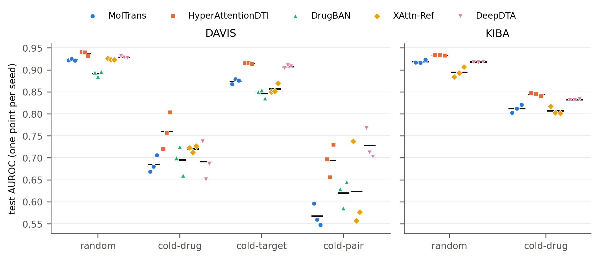
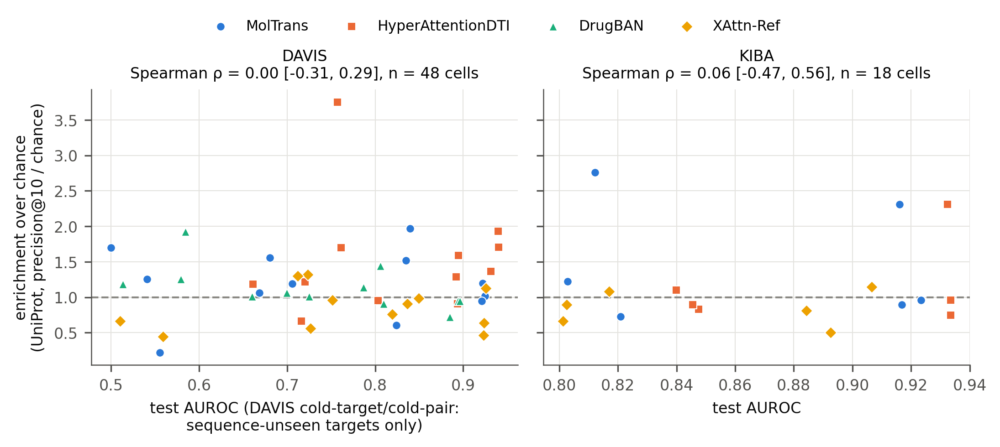

# Supplementary Information

<!-- v3 (ISMB / Bioinformatics format), step 8, 2026-10-17. Assembled from paper/v2/supplement_methods.md and the parts moved out of the v3 main text (v2 Table 1 -> S3; v2 section 3.7 -> S5). Changes from v2: recipes.py tag line (53 -> 56, follows the uncommitted edit of that file); the mixed-precision paragraph (S2); the MolTrans interaction-map line (S4); the [MOLTRANS_FIG_X] placeholder removed from row e of the problem log; rows w and x added. Every digit has a source tag (`python scripts/check_number_provenance.py paper/v3_ismb/supplement.md`). The journal wants all supplementary text, figures and tables in one file (VENUE_SPEC.md). Figures 3 and 4 of paper/v2/figures/ are placed in S8 as Supplementary Figures S1 and S2. -->

## S1 Split sizes

One fixed split per level; the rows below are the data rows of the split files, whose SHA-256 hashes
are recorded in `data/splits/MANIFEST.json`. Only the random and cold-drug levels of KIBA were trained.

**Supplementary Table S1.** Rows per split (train / validation / test).

| dataset | level | train | validation | test |
|---|---|---|---|---|
| DAVIS | random | 21,039 | 3,006 | 6,011 | <!-- src: data/splits/davis/random/train.csv#rows = 21039 --> <!-- src: data/splits/davis/random/valid.csv#rows = 3006 --> <!-- src: data/splits/davis/random/test.csv#rows = 6011 -->
| DAVIS | cold-drug | 21,658 | 2,652 | 5,746 | <!-- src: data/splits/davis/cold_drug/train.csv#rows = 21658 --> <!-- src: data/splits/davis/cold_drug/valid.csv#rows = 2652 --> <!-- src: data/splits/davis/cold_drug/test.csv#rows = 5746 -->
| DAVIS | cold-target | 21,080 | 2,992 | 5,984 | <!-- src: data/splits/davis/cold_target/train.csv#rows = 21080 --> <!-- src: data/splits/davis/cold_target/valid.csv#rows = 2992 --> <!-- src: data/splits/davis/cold_target/test.csv#rows = 5984 -->
| DAVIS | cold-pair | 15,190 | 264 | 1,144 | <!-- src: data/splits/davis/cold_pair/train.csv#rows = 15190 --> <!-- src: data/splits/davis/cold_pair/valid.csv#rows = 264 --> <!-- src: data/splits/davis/cold_pair/test.csv#rows = 1144 -->
| KIBA | random | 82,778 | 11,825 | 23,651 | <!-- src: data/splits/kiba/random/train.csv#rows = 82778 --> <!-- src: data/splits/kiba/random/valid.csv#rows = 11825 --> <!-- src: data/splits/kiba/random/test.csv#rows = 23651 -->
| KIBA | cold-drug | 83,807 | 12,073 | 22,374 | <!-- src: data/splits/kiba/cold_drug/train.csv#rows = 83807 --> <!-- src: data/splits/kiba/cold_drug/valid.csv#rows = 12073 --> <!-- src: data/splits/kiba/cold_drug/test.csv#rows = 22374 -->

Cold-pair discards every pair with exactly one unseen entity, so it trains on fewer rows than the
random level (15,190 against 21,039 on DAVIS). A volume-matched control for this exists for XAttn-Ref
but is not used in this manuscript.
<!-- src: data/splits/davis/cold_pair/train.csv#rows = 15190 -->
<!-- src: data/splits/davis/random/train.csv#rows = 21039 -->

## S2 Training recipes

Each published model is trained from its vendored repository (`baselines/`) with its authors'
optimiser, learning rate, batch size and tokeniser; only data loading is replaced. The commands are
built by `src/cloud/recipes.py`, which reproduces the flags of the notebooks that trained the cells.

**Supplementary Table S2.** Optimiser, learning rate and batch size per model.

| model | optimiser | learning rate | batch | notes |
|---|---|---|---|---|
| DeepDTA | Adam | 0.001 | 256 | PyTorch port; patience 10 <!-- src: src/model/train_deepdta.py:144 = 0.001 --> <!-- src: src/cloud/recipes.py:22 = 256 --> <!-- src: src/cloud/recipes.py:56 = 10 -->
| HyperAttentionDTI | AdamW, cyclic learning rate | 0.00005 | 32 | weight decay 0.0001 on weights, none on biases <!-- src: src/model/train_hyperattentiondti.py:15 = 0.00005, 0.0001 --> <!-- src: src/cloud/recipes.py:21 = 32 -->
| MolTrans | Adam | 0.0001 | 16 | configuration `BIN_config_DBPE` <!-- src: src/model/train_moltrans.py:236 = 0.0001 --> <!-- src: src/cloud/recipes.py:23 = 16 -->
| DrugBAN | Adam | 0.00005 | 64 | domain adaptation off; DAVIS only <!-- src: src/cloud/recipes.py:24 = 64, 0.00005 -->
| XAttn-Ref | Adam, reduce-on-plateau | 0.001 | 64 | learning rate halved after 5 epochs without improvement <!-- src: src/model/train.py:311 = 0.001 --> <!-- src: src/cloud/recipes.py:20 = 64 --> <!-- src: src/model/train.py:227 = 5 -->

**Mixed precision on KIBA.** DeepDTA and HyperAttentionDTI were trained with mixed precision (float16 autocast) on KIBA, as recorded in each cell's results file; MolTrans (whose layer normalisation underflows in half precision) and XAttn-Ref were trained in full precision, as was every DAVIS cell. The choice was validated beforehand on one DAVIS cell, HyperAttentionDTI at cold-pair, with three seeds per arm: test AUROC was 0.694 ± 0.038 in full precision (Kaggle, torch 2.10) and 0.681 ± 0.068 in mixed precision (Colab, torch 2.11), and precision@10 was 0.022 ± 0.012 against 0.023 ± 0.018, so the mixed-precision means lay within the full-precision seed spread. Three seeds per arm detect only a gross effect and cannot show equivalence, and the two arms also differed in library version and machine.
<!-- src: results/amp_validation_davis.md:10 = 0.694, 0.038, 2.10 -->
<!-- src: results/amp_validation_davis.md:11 = 0.681, 0.068, 2.11 -->
<!-- src: results/amp_validation_davis.md:12 = 0.022, 0.012 -->
<!-- src: results/amp_validation_davis.md:13 = 0.023, 0.018 -->

Two defects in the vendored MolTrans code are contained without editing it. Its forward pass reshapes
by the configured batch size, so a final partial batch would be scored wrongly; the batch size is set
per batch (`_fit_batch_size`). And one functional dropout call omits the training flag
(`baselines/MolTrans/models.py:103`), so dropout stays active at inference: its test metrics are one
draw of that noise, as in the published model. On DAVIS cold-pair, six further draws of one checkpoint
spread its test AUROC over 0.5862–0.5954, and the recorded value lies inside that range.
<!-- src: results/accuracy_v2/moltrans_coldpair_investigation.json#$.cells.cold_pair_seed1.arms.seeded[1].auroc = 0.5862 -->
<!-- src: results/accuracy_v2/moltrans_coldpair_investigation.json#$.cells.cold_pair_seed1.arms.seeded[0].auroc = 0.5954 -->

**Supplementary Table S3.** Test AUROC, mean ± standard deviation over three training seeds. "Sequence-unseen" scores
only test targets whose sequence does not occur in training (Section 3.6). DrugBAN has no KIBA cells.
*Source:* `results/accuracy_v2/by_model.csv`.

| model | DAVIS random | DAVIS cold-drug | DAVIS cold-target | cold-target, sequence-unseen | DAVIS cold-pair | cold-pair, sequence-unseen | KIBA random | KIBA cold-drug |
|---|---|---|---|---|---|---|---|---|
| MolTrans | 0.923 ± 0.002 | 0.685 ± 0.019 | 0.874 ± 0.006 | 0.833 ± 0.008 | 0.568 ± 0.025 | 0.532 ± 0.029 | 0.919 ± 0.004 | 0.812 ± 0.009 <!-- src: results/accuracy_v2/by_model.csv#dataset=davis&model=moltrans&level=random&view=uncorrected->auroc_mean,auroc_sd = 0.923, 0.002 --><!-- src: results/accuracy_v2/by_model.csv#dataset=davis&model=moltrans&level=cold_drug&view=uncorrected->auroc_mean,auroc_sd = 0.685, 0.019 --><!-- src: results/accuracy_v2/by_model.csv#dataset=davis&model=moltrans&level=cold_target&view=uncorrected->auroc_mean,auroc_sd = 0.874, 0.006 --><!-- src: results/accuracy_v2/by_model.csv#dataset=davis&model=moltrans&level=cold_target&view=unseen_by_sequence->auroc_mean,auroc_sd = 0.833, 0.008 --><!-- src: results/accuracy_v2/by_model.csv#dataset=davis&model=moltrans&level=cold_pair&view=uncorrected->auroc_mean,auroc_sd = 0.568, 0.025 --><!-- src: results/accuracy_v2/by_model.csv#dataset=davis&model=moltrans&level=cold_pair&view=unseen_by_sequence->auroc_mean,auroc_sd = 0.532, 0.029 --><!-- src: results/accuracy_v2/by_model.csv#dataset=kiba&model=moltrans&level=random&view=uncorrected->auroc_mean,auroc_sd = 0.919, 0.004 --><!-- src: results/accuracy_v2/by_model.csv#dataset=kiba&model=moltrans&level=cold_drug&view=uncorrected->auroc_mean,auroc_sd = 0.812, 0.009 --> |
| HyperAttentionDTI | 0.937 ± 0.005 | 0.760 ± 0.042 | 0.915 ± 0.001 | 0.893 ± 0.001 | 0.694 ± 0.038 | 0.713 ± 0.050 | 0.933 ± 0.001 | 0.844 ± 0.004 <!-- src: results/accuracy_v2/by_model.csv#dataset=davis&model=hyperattentiondti&level=random&view=uncorrected->auroc_mean,auroc_sd = 0.937, 0.005 --><!-- src: results/accuracy_v2/by_model.csv#dataset=davis&model=hyperattentiondti&level=cold_drug&view=uncorrected->auroc_mean,auroc_sd = 0.760, 0.042 --><!-- src: results/accuracy_v2/by_model.csv#dataset=davis&model=hyperattentiondti&level=cold_target&view=uncorrected->auroc_mean,auroc_sd = 0.915, 0.001 --><!-- src: results/accuracy_v2/by_model.csv#dataset=davis&model=hyperattentiondti&level=cold_target&view=unseen_by_sequence->auroc_mean,auroc_sd = 0.893, 0.001 --><!-- src: results/accuracy_v2/by_model.csv#dataset=davis&model=hyperattentiondti&level=cold_pair&view=uncorrected->auroc_mean,auroc_sd = 0.694, 0.038 --><!-- src: results/accuracy_v2/by_model.csv#dataset=davis&model=hyperattentiondti&level=cold_pair&view=unseen_by_sequence->auroc_mean,auroc_sd = 0.713, 0.050 --><!-- src: results/accuracy_v2/by_model.csv#dataset=kiba&model=hyperattentiondti&level=random&view=uncorrected->auroc_mean,auroc_sd = 0.933, 0.001 --><!-- src: results/accuracy_v2/by_model.csv#dataset=kiba&model=hyperattentiondti&level=cold_drug&view=uncorrected->auroc_mean,auroc_sd = 0.844, 0.004 --> |
| DrugBAN | 0.891 ± 0.006 | 0.695 ± 0.033 | 0.846 ± 0.010 | 0.801 ± 0.012 | 0.620 ± 0.031 | 0.559 ± 0.040 | — | — <!-- src: results/accuracy_v2/by_model.csv#dataset=davis&model=drugban&level=random&view=uncorrected->auroc_mean,auroc_sd = 0.891, 0.006 --><!-- src: results/accuracy_v2/by_model.csv#dataset=davis&model=drugban&level=cold_drug&view=uncorrected->auroc_mean,auroc_sd = 0.695, 0.033 --><!-- src: results/accuracy_v2/by_model.csv#dataset=davis&model=drugban&level=cold_target&view=uncorrected->auroc_mean,auroc_sd = 0.846, 0.010 --><!-- src: results/accuracy_v2/by_model.csv#dataset=davis&model=drugban&level=cold_target&view=unseen_by_sequence->auroc_mean,auroc_sd = 0.801, 0.012 --><!-- src: results/accuracy_v2/by_model.csv#dataset=davis&model=drugban&level=cold_pair&view=uncorrected->auroc_mean,auroc_sd = 0.620, 0.031 --><!-- src: results/accuracy_v2/by_model.csv#dataset=davis&model=drugban&level=cold_pair&view=unseen_by_sequence->auroc_mean,auroc_sd = 0.559, 0.040 --> |
| XAttn-Ref | 0.924 ± 0.001 | 0.721 ± 0.008 | 0.857 ± 0.011 | 0.835 ± 0.015 | 0.624 ± 0.099 | 0.607 ± 0.128 | 0.894 ± 0.011 | 0.807 ± 0.009 <!-- src: results/accuracy_v2/by_model.csv#dataset=davis&model=coldsite_dti&level=random&view=uncorrected->auroc_mean,auroc_sd = 0.924, 0.001 --><!-- src: results/accuracy_v2/by_model.csv#dataset=davis&model=coldsite_dti&level=cold_drug&view=uncorrected->auroc_mean,auroc_sd = 0.721, 0.008 --><!-- src: results/accuracy_v2/by_model.csv#dataset=davis&model=coldsite_dti&level=cold_target&view=uncorrected->auroc_mean,auroc_sd = 0.857, 0.011 --><!-- src: results/accuracy_v2/by_model.csv#dataset=davis&model=coldsite_dti&level=cold_target&view=unseen_by_sequence->auroc_mean,auroc_sd = 0.835, 0.015 --><!-- src: results/accuracy_v2/by_model.csv#dataset=davis&model=coldsite_dti&level=cold_pair&view=uncorrected->auroc_mean,auroc_sd = 0.624, 0.099 --><!-- src: results/accuracy_v2/by_model.csv#dataset=davis&model=coldsite_dti&level=cold_pair&view=unseen_by_sequence->auroc_mean,auroc_sd = 0.607, 0.128 --><!-- src: results/accuracy_v2/by_model.csv#dataset=kiba&model=coldsite_dti&level=random&view=uncorrected->auroc_mean,auroc_sd = 0.894, 0.011 --><!-- src: results/accuracy_v2/by_model.csv#dataset=kiba&model=coldsite_dti&level=cold_drug&view=uncorrected->auroc_mean,auroc_sd = 0.807, 0.009 --> |
| DeepDTA | 0.929 ± 0.002 | 0.692 ± 0.044 | 0.907 ± 0.003 | 0.884 ± 0.003 | 0.728 ± 0.035 | 0.749 ± 0.044 | 0.918 ± 0.001 | 0.832 ± 0.001 <!-- src: results/accuracy_v2/by_model.csv#dataset=davis&model=deepdta&level=random&view=uncorrected->auroc_mean,auroc_sd = 0.929, 0.002 --><!-- src: results/accuracy_v2/by_model.csv#dataset=davis&model=deepdta&level=cold_drug&view=uncorrected->auroc_mean,auroc_sd = 0.692, 0.044 --><!-- src: results/accuracy_v2/by_model.csv#dataset=davis&model=deepdta&level=cold_target&view=uncorrected->auroc_mean,auroc_sd = 0.907, 0.003 --><!-- src: results/accuracy_v2/by_model.csv#dataset=davis&model=deepdta&level=cold_target&view=unseen_by_sequence->auroc_mean,auroc_sd = 0.884, 0.003 --><!-- src: results/accuracy_v2/by_model.csv#dataset=davis&model=deepdta&level=cold_pair&view=uncorrected->auroc_mean,auroc_sd = 0.728, 0.035 --><!-- src: results/accuracy_v2/by_model.csv#dataset=davis&model=deepdta&level=cold_pair&view=unseen_by_sequence->auroc_mean,auroc_sd = 0.749, 0.044 --><!-- src: results/accuracy_v2/by_model.csv#dataset=kiba&model=deepdta&level=random&view=uncorrected->auroc_mean,auroc_sd = 0.918, 0.001 --><!-- src: results/accuracy_v2/by_model.csv#dataset=kiba&model=deepdta&level=cold_drug&view=uncorrected->auroc_mean,auroc_sd = 0.832, 0.001 --> |

## S4 Readout sensitivity

A multi-head, multi-channel attention model must be reduced to one weight per residue. Besides the
primary readout (Section 2.2), the following reductions were scored with the same pipeline:
XAttn-Ref's protein self-attention, HyperAttentionDTI's maximum over channels and its receptive-field
spread, MolTrans's maximum over heads and its first layer, MolTrans's drug × protein interaction map,
and DrugBAN's maximum over atoms and receptive-field spread. The reductions disagree most for
HyperAttentionDTI against the KLIFS pocket at the cold-target level:

**Supplementary Table S4.** HyperAttentionDTI, KLIFS pocket, DAVIS cold-target.

| readout | precision@10 (mean ± SD over seeds) | chance |
|---|---|---|
| primary (channel mean) | 0.186 ± 0.032 | 0.140 | <!-- src: results/readout_comparison.csv#ground truth=klifs&model=hyperattentiondti&readout=published&level=cold_target->precision@10,chance = 0.186, 0.140 --> <!-- src: results/effects_v2_2d/enrichment.csv#family=S3-D&model=hyperattentiondti&level=cold_target->precision = 0.186 --> <!-- sd: readout_comparison.csv cell "0.186 ± 0.032" --> <!-- src: results/readout_comparison.csv:40 = 0.032 -->
| maximum over channels | 0.367 ± 0.104 | 0.140 | <!-- src: results/readout_comparison.csv#ground truth=klifs&model=hyperattentiondti&readout=maxchannel&level=cold_target->precision@10,chance = 0.367, 0.140 --> <!-- src: results/readout_comparison.csv:52 = 0.104 -->
| receptive-field spread | 0.081 ± 0.046 | 0.140 | <!-- src: results/readout_comparison.csv#ground truth=klifs&model=hyperattentiondti&readout=receptive&level=cold_target->precision@10,chance = 0.081, 0.140 --> <!-- src: results/readout_comparison.csv:56 = 0.046 -->

The readout-comparison table is written by the readout runs to the checkpoint-side results folder
and is versioned in the repository as `results/readout_comparison.csv` (a byte-identical copy). Drug dependence of each readout was measured on 25 proteins with four
drugs each: the top ten residues are identical across drugs in 100% of drug pairs for MolTrans's
primary readout, in 72% for HyperAttentionDTI's and in 0% for DrugBAN's.
<!-- src: results/drug_dependence/moltrans.txt:1 = 25, 100 -->
<!-- src: results/drug_dependence/hyperattentiondti.txt:1 = 72 -->
<!-- src: results/drug_dependence/drugban.txt:1 = 0 -->
MolTrans's drug × protein interaction map, scored as a readout variant, gives identical top-ten residues across drugs in 0% of the same 150 drug pairs.
<!-- src: results/drug_dependence/moltrans_interaction.txt:1 = 0, 150 -->

## S5 Integrated gradients on the same weights (confirmatory)

Integrated gradients (Sundararajan et al., 2017; 32 steps) on the same checkpoints localise better than the attention in some cells, not
all.
<!-- src: src/evaluation/integrated_gradients.py:56 = 32 --> For XAttn-Ref at DAVIS cold-drug, IG reaches 3.16 [2.40, 4.40]× chance in the pocket against the
attention's 2.10 [1.83, 2.36]×. For HyperAttentionDTI at KIBA cold-drug, IG's point estimate against
UniProt residues, 1.90×, is above the attention's 0.94 [0.71, 1.19]×, but with seeds resampled its
interval, [0.63, 3.39], includes parity. IG coverage is partial
(this Supplement, S6), and we read it only as evidence that a weak attention map can under-report
what a model represents.
<!-- src: results/effects_v2_2d/enrichment.csv#family=S2&model=hyperattentiondti_ig&level=cold_drug->enrichment,enrichment_low,enrichment_high = 1.90, 0.63, 3.39 -->
<!-- src: results/effects_v2_2d/enrichment.csv#family=P2&model=hyperattentiondti&level=cold_drug->enrichment,enrichment_low,enrichment_high = 0.94, 0.71, 1.19 -->
<!-- src: results/effects_v2_2d/enrichment.csv#family=S1-klifs&model=coldsite_dti_ig&level=cold_drug->enrichment,enrichment_low,enrichment_high = 3.16, 2.40, 4.40 -->
<!-- src: results/effects_v2_2d/enrichment.csv#family=S3-D&model=coldsite_dti&level=cold_drug->enrichment,enrichment_low,enrichment_high = 2.10, 1.83, 2.36 -->

## S6 Where each instrument was run

| instrument | code | outputs |
|---|---|---|
| audit with Holm (primary record) | `src/evaluation/run_audit.py` | `results/analysis_{davis,kiba}_policyA/audit_*_10k_permutations.*` |
| UniProt and KLIFS ladders | `src/evaluation/run_ladder.py` | `results/analysis_*_policyA*/` |
| enrichment and faithfulness intervals (two-way: seeds and targets resampled; quoted in the text) | `src/evaluation/effects_v2.py --resample seeds_and_targets` | `results/effects_v2_2d/` |
| enrichment and faithfulness intervals (targets only, as the amendment specified; comparison) | `src/evaluation/effects_v2.py` | `results/effects_v2/` |
| readout comparison | readout runs (checkpoint-side), copied byte-identical | `results/readout_comparison.csv` |
| seed agreement | `src/evaluation/seed_agreement.py` | `results/seed_agreement.md` |
| positive control | `src/evaluation/positive_control.py` | `results/positive_control_{davis,kiba}.md` |
| positional and residue nulls | `src/evaluation/positional_control.py` | all four attention models on DAVIS, UniProt and KLIFS (`results/analysis_davis_policyA/positional_control_*`); HyperAttentionDTI and MolTrans on KIBA against both ground truths, XAttn-Ref on KIBA against KLIFS only (`results/analysis_kiba_policyA/positional_control_*`) |
| faithfulness (committed means) | `src/evaluation/run_faithfulness.py`, `token_faithfulness.py` | `results/analysis_*_policyA/` |
| accuracy and accuracy-vs-localization | `src/evaluation/accuracy_table.py` | `results/accuracy_v2/` |
| leakage retraining | `src/evaluation/leakage_retrain.py` | `results/leakage_retrain_davis.md` |

## S7 Threats to validity: the problem log

**Supplementary Table S5.** Problems found during the project, their effect, and how each is handled.
"Open" marks a problem that remains a limitation of this manuscript.

| # | problem | effect if unhandled | handling | status / evidence |
|---|---|---|---|---|
| a | DAVIS mutants carry the wild-type sequence | "unseen" targets partly seen; cold accuracy inflated | sequence policy; leak quantified by retraining | handled — `results/sequence_audit_davis.md`, `results/leakage_retrain_davis.md` |
| b | vendored MolTrans re-seeds the random generator on import | every seed trains as the first seed | seed after import; import wrapped to preserve generator state; affected cells retrained | handled — `tests/test_train_moltrans.py`, `tests/test_integrity_rng_seeds.py` |
| c | masking arms not size-matched for a sub-word model | random arm is roughly twice the intervention, biasing faithfulness | token-matched control | handled — `results/mask_comparability_davis.md` |
| d | match quality of MolTrans's token-matched control not recorded; matching can fail when attention sits at a sequence end | some control draws may exceed the tolerance | reported as a limitation | open — ledger T02, discovered items |
| e | the primary readouts may differ from the maps the papers display; not confirmed against their figures | a primary verdict may concern a different map | alternative readouts scored as variants (MolTrans's interaction map; others in S4) | open — `docs/readout_sources.md` |
| f | permutation resolution was 500 in the original audit | smallest p close to the smallest Holm threshold | 10,000-permutation audit is the primary record; verdicts unchanged | handled — `docs/PROTOCOL_AMENDMENT_v2.md` §2.1 | <!-- src: docs/REMEDIATION_LEDGER.md:592 = 500, 10000 -->
| g | two vendored repositories ship a module with the same name | one model silently loads the other's code | modules loaded in isolation | handled — `tests/test_drugban_import_isolation.py` |
| h | the analysis runner skipped finished outputs | a partial grid would freeze missing levels silently | runner refuses a changed grid outside a scratch folder | handled — `src/evaluation/run_all.py`, `tests/test_integrity_grid.py` |
| i | faithfulness depends on the number of residues masked | a verdict could reflect the chosen k | k = 10 fixed in advance; k = 50 as sensitivity for two models | handled — `results/faithfulness_k50_davis/` | <!-- src: docs/PROTOCOL_AMENDMENT_v2.md:163 = 10 --> <!-- src: docs/PROTOCOL_AMENDMENT_v2.md:169 = 50 -->
| j | DrugBAN's loader caps molecules at a fixed atom count | rows silently dropped | collector skips and fails loudly above a limit; the limit is a floor of three rows or 1%, whichever is larger | handled; limit wording corrected — ledger D6 | <!-- src: docs/REMEDIATION_LEDGER.md:242 = 1 -->
| k | MolTrans keeps dropout on at inference | single-draw test metrics and faithfulness re-runs differ slightly | forward passes seeded for explanations; stated | open (as published) — ledger T04, T05 |
| l | HyperAttentionDTI masking would have written alanine; its positive logit was read alone | a different intervention and a quantity that can move without the prediction | mask to `X` via each model's tokeniser; log-odds | handled — `src/evaluation/residue_space.py` |
| m | ground-truth residues numbered along UniProt, not along the dataset sequence | sites point at the wrong residue or past the end | alignment-based re-numbering; the positive control fails on un-renumbered sites | handled — `src/data/align_ground_truth.py` |
| n | tied attention broken by a stable sort | positional artefact read as quality | ties broken at random | handled — `src/evaluation/precision_at_k.py` |
| o | Holm families enlarged after first results | post-hoc family definition | disclosed; frozen by dated amendment | disclosed — `docs/PROTOCOL_AMENDMENT_v2.md` G4 |
| p | faithfulness re-runs do not reproduce the committed means exactly for MolTrans and for HyperAttentionDTI on DAVIS | intervals describe a re-run draw | committed means stay primary; verdict signs unchanged | open — ledger T05 |
| q | an interrupted checkpoint was once analysed | a partly trained model scored as final | runner refuses a checkpoint without its results file | handled — `CLAUDE.md` §6 |
| r | no random-generator state or initial-weight hash recorded for the trained cells | seed distinctness not provable after the fact | recorded for all future cells by the cloud harness | open for existing cells — ledger T01 |
| s | DAVIS cold-pair validation contains seen-by-sequence targets | checkpoint selection influenced by the leak | cannot be undone without retraining | open — `results/sequence_audit_davis.md` |
| t | no conservation control for the pocket enrichment | enrichment may reflect conserved residues | none | open — amendment A1/A7 |
| u | the sampled 1,000-permutation per-seed p put one seed on the α line | headline disagreement count 12 vs 11 | exact p recomputed independently; 11 reported, 12 disclosed | handled — `scripts/certification/step1b_exact_p_validation.py` | <!-- src: results/seed_agreement.md:34 = 12 --> <!-- src: results/certification/key_numbers.csv#name=seeds_disagree_exact->value = 11 --> <!-- src: results/certification/step1b_exact_p_validation.txt:19 = 1000 -->
| v | the leak's all-rows AUROC effect is not distinguishable from zero with three seeds | a small, insignificant number quoted as a finding | not quoted; leaked-row effect reported with its test | handled — `results/certification/step3_leak.txt` |
| w | the same seed and the same initial weights give different results on re-running (one pair of runs) | part of the "seed" variation is run-to-run variation, and the cause of the map disagreement is not isolated | stated as a limitation; both canary runs are reported | open — `docs/canary_attempts/README.md` | <!-- src: docs/canary_attempts/attempt1_canary_verdict_FAIL.json#$.metrics.auroc.new = 0.8868 --> <!-- src: docs/canary_attempts/attempt2_canary_verdict_PASS.json#$.metrics.auroc.new = 0.8494 -->
| x | the 10,000-permutation audit's cell p-values differ from an exact recomputation by up to 0.0511 on DAVIS and by 0.54 in one KIBA cell; the cause is not established | the survivor counts could differ | Holm recomputed from the exact p-values leaves the same survivors | open — `results/certification/step4_holm.txt` | <!-- src: results/certification/step4_holm.txt:8 = 0.0511 --> <!-- src: results/certification/step4_holm.txt:39 = 0.262374, 0.803548 --> <!-- src: derived: 0.803548 - 0.262374 = 0.54 --> <!-- src: docs/PROTOCOL_AMENDMENT_v2.md:54 = 10000 -->

For (c), 47.9% of tokens change under the attended arm and 95.0% under an unmatched random arm, on
20 DAVIS proteins. <!-- src: results/mask_comparability_davis.md:5 = 47.9 -->
<!-- src: results/mask_comparability_davis.md:6 = 95.0 -->
<!-- src: results/mask_comparability_davis.md:3 = 20 -->

## S8 Supplementary figures

**Supplementary Figure S1. Predictive accuracy per training seed.** Test AUROC of every cell (points, one per seed; bar = mean) on the uncorrected test sets. DeepDTA has no attention and anchors accuracy. KIBA has two levels (random, cold-drug) and no DrugBAN cells.

**Supplementary Figure S2. Accuracy does not predict localisation.** One point per attention-model cell and seed: test AUROC against enrichment over chance (UniProt, precision@10 divided by chance). For DAVIS cold-target and cold-pair, AUROC is scored on sequence-unseen targets, the same policy the explanation metrics use. Panel titles give Spearman's ρ with a 95% bootstrap interval over cells.
<!-- src: docs/PROTOCOL_AMENDMENT_v2.md:190 = 95 -->

